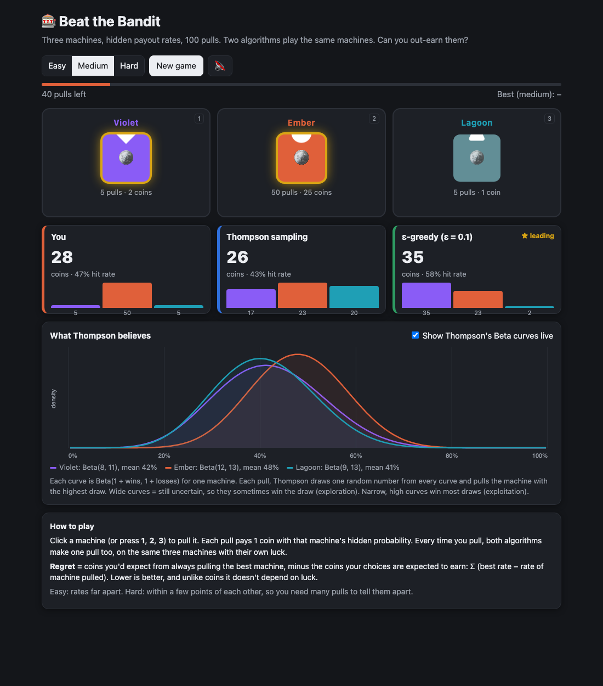

# Beat the Bandit 🎰

A single-file browser game about the **explore vs exploit** trade-off. Three slot machines have hidden payout rates, and you get 100 pulls. Two algorithms, **Thompson sampling** and **ε-greedy (ε = 0.1)**, play the same machines alongside you, one pull for each of yours. Can you out-earn them?



## Play

Open `index.html` in any browser. There's nothing to install and no server needed. Click a machine or press **1 / 2 / 3** to pull.

| Feature | Details |
|---|---|
| Difficulty | **Easy:** the best machine beats the others by ≥ 20 points. **Medium:** 8–20 points. **Hard:** all within 6 points. |
| Live scoreboard | coins, hit rate, a "★ leading" badge, and pulls per machine for each player |
| Beta curves toggle | shows Thompson's posterior Beta(1 + wins, 1 + losses) for each machine, updating every pull. The true rates appear as dashed lines at the end. |
| End screen | true rates, coins, pulls per machine and **regret** for all three players |
| Extras | animations, Web Audio sound effects (with a mute button), a high score per difficulty in `localStorage`, phone layout |

URL options (handy for demos): `?level=hard`, `?seed=7` (same machines every time), `?beta=1` (curves open), `?autoplay=60` (plays 60 pulls for you), `?noend=1`.

## The ideas behind it

- **Regret** = Σ over your pulls of (best rate − rate of the machine you pulled). It scores your *choices*, not your luck: you can earn more coins than Thompson and still have higher regret.
- **ε-greedy** pulls each machine once, then 90% of the time pulls the machine with the best average so far. The other 10% it picks uniformly among all three (leader included), so it never stops exploring.
- **Thompson sampling** draws one random number from each machine's Beta posterior and pulls the highest draw. Uncertain machines (wide curves) still win draws sometimes, and that's its exploration. As the curves narrow, it settles on the best machine.

### What 2,000 simulated games show (from `node test.mjs`)

| Difficulty | Thompson | ε-greedy | Random |
|---|---|---|---|
| Easy | 6.6 | 7.6 | 25.9 |
| Medium | 6.0 | 6.0 | 9.2 |
| Hard | 2.4 | 2.4 | 2.7 |

*Mean regret over 100 pulls; lower is better.*

On **Hard**, 100 pulls are barely enough to tell machines within 6 points apart, so even the algorithms only beat random by about 11%. The cost of not knowing is low when the options are similar. Over 100 pulls Thompson and ε-greedy are close; Thompson's advantage grows with longer horizons, because ε-greedy keeps spending 10% of its pulls exploring forever. This is the same pattern as HW4 Part 3D.

## Tests

```
node test.mjs
```

There are 23 checks. They load the `<script id="core">` block straight out of `index.html`, so the shipped code is what gets tested:

- **Seeded RNG:** deterministic, and in [0, 1).
- **Beta sampler** (Marsaglia–Tsang gamma): mean and variance for 4 parameter sets.
- **Beta pdf:** integrates to 1, matches known values, and lgamma is checked.
- **Difficulty rules:** hold over 2,000 games per level.
- **Regret:** matches a hand calculation.
- **ε-greedy:** tries each arm once, then sends exactly ε × 2/3 of its pulls to non-leaders.
- **Thompson:** exploits a clear winner.
- **Performance:** both algorithms beat random at every difficulty.

## Files

- `index.html`: the whole game (HTML, CSS and JS in one file)
- `test.mjs`: Node tests (Node 18+)
- `screenshots/`: images for this README and the portfolio
